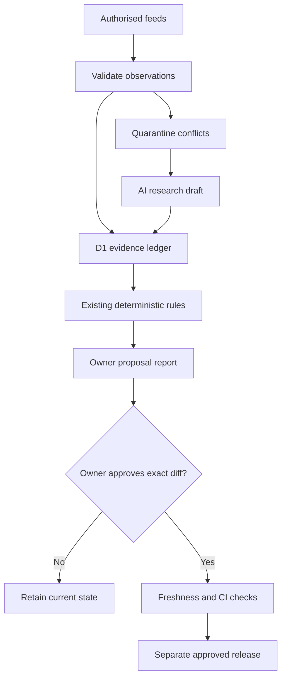

# Cloudflare CORE operations agent — feasibility only

**Recommendation: feasible, but begin with a deterministic read-only evidence pipeline.** Authorised data access and exact identity/delivery evidence are harder than scheduling compute. A model should investigate exceptions and draft explanations; it must not decide whether its own invented observations satisfy the buying rules. No agent, schedule, database or paid infrastructure was deployed/provisioned in Phase 6A.

## Phased design

| Phase | Scope | Cloudflare services | Exit evidence |
|---|---|---|---|
| A: local evidence rehearsal | Owner-supplied/authorised feed samples; parse exact identity, stock, price, delivery, timestamps; dry-run existing rules | None required | Known mismatches, stale records, unknown delivery and retries fail safely; compare against manual checks |
| B: scheduled read-only pilot | One authorised retailer, then a second; fetch at provider-permitted cadence, propose reports only | Worker Cron Trigger; D1 observations; optional R2 permitted raw snapshots | 14-day shadow run, provenance complete, no wrong-model acceptance, quantified manual correction rate and cost |
| C: exception research assistant | Manufacturer documentation and conflicting feed observations; proposed alternatives never active automatically | Agents SDK on SQLite-backed Durable Object; Workflows for multi-step research/retries; optional bounded model API | Owner can reproduce citations; injection/failure tests pass; time saved exceeds review burden |
| D: owner-approved change preparation | Generate exact proposal diff and approval report; rerun deterministic validation and existing tests | Worker/Workflow plus restricted GitHub integration, separate approval store | Approval bound to exact evidence IDs, base SHA and proposed diff; fresh revalidation before applying |
| E: marketing intelligence | Draft approved-research summaries, campaign reports and recurring topic suggestions | Existing agent/report store; optional newsletter API after separate approval | Claims retain provenance; owner approves publication; subscriber data isolated from research |

Use one scheduled orchestrator, not overlapping Cron/Agent schedules for the same job. Cron is sufficient for Phase B. Agents SDK becomes useful for persistent review state, scheduling and interactive owner tasks; it is not required merely to fetch a feed. Workflows provides durable steps, retries and pause/resume for longer jobs [S15]. Avoid permanent WebSocket connections, browser automation and a vector database until a measured need exists.

## Flow and authority

AI research records are typed as proposals and cannot be promoted into verified purchasing observations merely by writing to the ledger. Store verified observations and proposed claims in separate tables/permissions. Existing engine rules consume only validated evidence in the established schema. A failing/late job never makes a prior price fresh or changes HOLD to BUY.

## Data and provenance

`source_registry`: retailer/provider, permitted URLs/endpoints, licence purpose, caching/retention terms, rate limit, approval date, expiry, credential binding name. Awin account approval does not itself authorise every feed or use. Amazon affiliate destinations remain independent; do not scrape Amazon or assume its product APIs permit CORE's monitoring/alerts.

`observation`: immutable ID; source and retrieval URL; fetched_at; source_observed_at if supplied; exact MPN/EAN/source SKU; variant/condition/seller; item price in integer pence; currency/VAT status; stock/dispatch; delivery charge or unknown; region/quote scope; raw evidence hash/reference; parser version; validation result/reason. A fetched timestamp alone cannot establish a current retailer observation when the payload is old/cached.

`delivery_quote`: retailer basket fingerprint, item coverage, amount, destination class, quotation time and terms. Include a private postcode only if separately authorised and necessary; keep it out of public reports and AI prompts. Never silently use a national advertisement as a postcode-specific quote, unknown shipping as zero, or apply one basket shipping charge to each part.

`compatibility_claim`: exact models/revisions, manufacturer manual URL/version/page, quoted factual fields within permitted use, retrieval date, interpretation, reviewer, and physical acceptance required flag. Socket, BIOS, dimensions, cabling and PSU connector compatibility remain deterministic checks where possible. Manufacturer dimensions do not certify fan/RAM/panel clearance or physical testing.

`proposal`: base release SHA; affected component IDs/configurations; old/new values; evidence IDs; rule version; guide impact; risks; proposed status; expiry; content hash. `approval`: authenticated owner, timestamp, proposal hash, decision and rationale. `audit_event`: job ID, action, before/after hashes, actor/tool version, source references and outcome. Raw snapshots go in private R2 only when licence permits; otherwise retain allowed fields/hash and retrieval metadata. Workflow state retention is not the audit-log retention policy.

D1 owns cross-run observations/reports; the Agent's Durable Object holds workflow/review state. Avoid keeping two authoritative copies of purchasing facts. R2 holds permitted source artifacts, not arbitrary full retailer-site archives. KV is optional for non-authoritative cache/config; do not rely on eventually consistent cache for approval or budget locks.

## Failures, security and cost control

- Exact identity mismatch, missing VAT, unknown delivery, ambiguous seller, preorder, stale timestamp, conflicting stock or invalid price → quarantine; no positive buying advice. Source timeout → preserve original timestamp, mark failure and let the existing freshness rule expire evidence.
- Bound retries: at most three attempts with exponential backoff/jitter; obey Retry-After and source terms. Circuit-break a repeatedly failing source, record the gap and alert the owner in an approved report channel. Use idempotent observation/job IDs to prevent duplicate quotes or approvals after retries.
- Treat retailer/manufacturer text as untrusted data. It cannot alter system instructions, approve components, call arbitrary tools or reveal secrets. Allowlist fetch destinations, block private/internal IPs and redirect escapes, limit response size/type/time and parse only expected schemas. No arbitrary code execution from retrieved pages.
- Keep source API keys in Worker secrets, never client code/repo/model prompts. Separate development and production accounts/bindings where practical. Owner report UI uses authenticated access and server-side authorisation; every RPC/action is checked. Public links must not reveal raw evidence containing private basket information.
- Phase B has no production-write credential. Later GitHub credential is scoped to proposal branches/PRs only, not merging or deploying. Approval binds to an immutable proposal and base SHA; changed evidence, expired observations or changed main invalidate it. Re-run fresh data/CI checks before a separately approved release. Hardware/guide changes retain their own approval gates.
- Daily request/token/byte/job quotas enforced in a strongly consistent budget record before reserving work; concurrency capped at two source fetches initially. Proposed cap: 300 source requests/day, three retries maximum, 20 model jobs/day, 6,000 input and 1,000 output tokens/job. Use a monthly owner-approved money cap and kill switch. A provider billing alert is not a hard spending cap.
- Retention proposal: 90 days observations/raw permitted samples, 12 months decision/audit records; adjust to licence and operational need. Secure logs redact credentials/personal data. Export audit records with version/hash checks; test recovery and schema migrations. These are approval proposals, not deployed controls.

## Cost assessment at a small catalogue size

Illustrative load: 30 exact products × two permitted source observations × four checks/day = 240 observations/day, about 7,200 in a 30-day month. This is an upper-bound request count if there is one request per product; a permitted bulk feed can be cheaper. With five Workflow steps per observation that is 1,200 steps/day or 36,000/month, before retries/additional research. At an assumed 2KB normalised observation, raw row payload is about 14.4MB/month before indexes and metadata. At 50KB permitted raw evidence per observation, snapshots are about 360MB/month. These are workload assumptions, not a measured deployment.

Current official pricing [S16]: Workers Paid begins at $5/month and includes 10 million requests/30 million CPU milliseconds monthly. Workflows Free has 100,000 shared requests/day, 10ms CPU/invocation, 1GB-month and 3,000 steps/day; Paid includes 500,000 steps/month, with $0.80 per additional 100,000, and 1GB-month storage then $0.20/GB-month. The small example fits the request/step allowances, but **10ms CPU may be insufficient for parsing/research**; benchmark before promising a free production agent. Account-wide shared usage, Durable Objects, D1/R2 operations and model inference must be included.

SQLite Durable Objects are available on Free; Free limits include 100,000 requests/day and 13,000 GB-s duration/day [S17]. Idle non-hibernating objects can incur duration cost. Prefer short operations and Workflow wait states instead of keeping a chat agent active during long remote requests.

Workers AI supplies 10,000 neurons/day free; above that on Paid, published pricing is $0.011/1,000 neurons, with model-specific token equivalents and some paid-only models [S18]. For illustration, 20 daily jobs at 6,000 input/1,000 output tokens total 3.6M input/0.6M output tokens/month. At the documented Llama 3.3 70B FP8 rates ($0.293/M input; $2.253/M output), nominal inference is about $2.41/month before free allowances. This is a cost example, **not model-quality approval**; search tools, reruns and stronger models may cost more. An external model/search API would be additional and needs its own quote/cap.

Planning envelope after approval: £0 for local rehearsal; potentially $0 for a tightly bounded Free shadow pilot; allow **$5–$15/month plus tax** for a small paid pilot if benchmarking justifies it, with a proposed $20 monthly stop/review budget. These are estimates, not current CORE bills or automatic spending authorisation. Data licensing and human review can exceed compute costs. No browser-rendering, paid feeds or paid search budget is assumed. If a source requires expensive access, revisit the source or monitoring scope before provision.

## Acceptance before any production influence

Create fixture tests for wrong MPN/variant, currency/VAT mismatch, future/stale timestamps, unknown delivery, duplicate shipping, delayed workflow resume, conflicting sources, replayed approval, changed main, prompt injection and quota exhaustion. Compare the existing deterministic engine's output against manual expected results. Run a 14-day shadow period and record wrong-model acceptance (must be zero in evaluated samples), quarantined errors, stale periods, approval reversals, cost and owner minutes. This sample does not prove universal reliability. Keep manual fallback and fail-closed status throughout. Advance only on evidence and owner approval.
